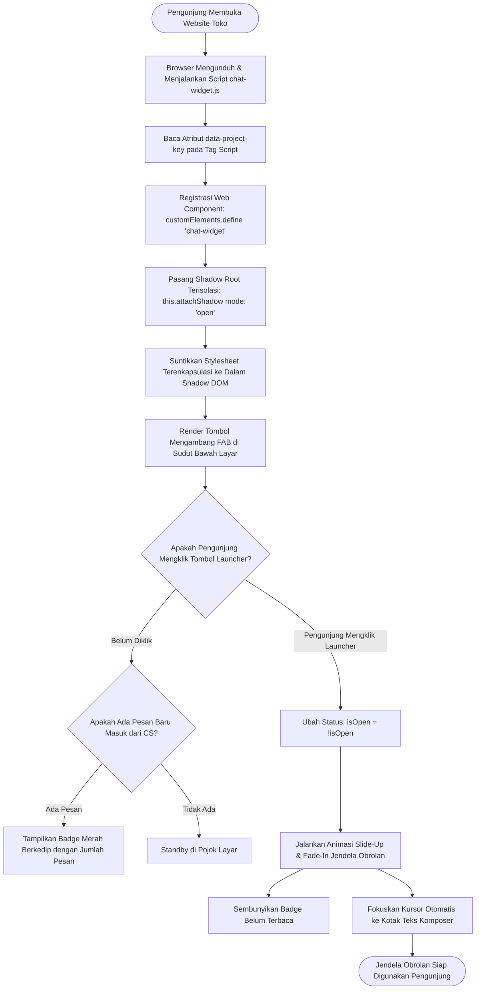

# Modul Peluncur Widget Mengambang & Isolasi Shadow DOM (Customer / Visitor)

## 1. Deskripsi Fitur
Modul Peluncur Widget (*Floating Launcher*) adalah gerbang interaksi visual pertama bagi pelanggan atau pengunjung website toko. Komponen ini dirancang dengan standar rekayasa kelas dunia (*Staff Engineer Standard*):
1. **Tombol Mengambang Elegan (*Floating Action Button - FAB*):** Berada di pojok bawah layar (kanan atau kiri) dengan efek bayangan halus (*soft elevation shadow*), animasi transisi lembut (*smooth scale & fade*), serta lencana angka pesan belum terbaca (*unread count badge*).
2. **Isolasi Penuh Web Components Shadow DOM:** Seluruh elemen UI widget di-render di dalam `#shadow-root (open)`. Hal ini menjamin 100% bahwa gaya CSS website toko (seperti Shopify, WordPress, atau Tailwind host) tidak akan pernah merusak tampilan widget, dan gaya widget tidak akan pernah bocor ke website toko (*Zero CSS Collision*).
3. **Desain Baku Anti-AI Slop (*Fixed Layout & Shape*):** Memiliki bentuk kurva, tombol pemicu, struktur bubble chat, dan composer yang identik di semua website toko, di mana kustomisasi hanya terbatas pada warna aksen brand utama (*Primary Accent Color*).

---

## 2. Hak Akses & Role Permission
- **Role:** `customer` (Pelanggan / Pengunjung Website)
- **Akses:** Bebas digunakan oleh seluruh pengunjung website tanpa perlu mendaftar akun terlebih dahulu (*Guest-Friendly*).

---

## 3. Komponen Teknis & Arsitektur SDK

### File Terkait:
- Paket SDK: `packages/chat-sdk/src/`
  - `widget.ts`: Custom Element Web Component `<chat-widget>`.
  - `shadow-dom.ts`: Injeksi template HTML dan stylesheet terenkapsulasi ke dalam `#shadow-root`.
  - `events.ts`: Event listener pemicu klik buka/tutup jendela obrolan.
- File CDN Publik: [chat-widget.js](file:///C:/laragon/www/%23Project2026/beantalk/public/chat-widget.js)
- Ukuran Bundle: Sangat ringan (< 25 KB gzipped), murni Vanilla TypeScript tanpa framework eksternal React/Vue.

---

## 4. Flowchart Siklus Hidup Pemuatan & Pembukaan Widget

---

## 5. Pengalaman Pengguna & Interaksi Visual

1. **Melihat Tombol Obrolan:**
   - Di pojok kanan bawah website toko, pengunjung akan melihat tombol bulat elegan berwarna brand toko (contoh: emas gelap untuk *Supresso* atau cokelat elegan untuk *Indraco*).
2. **Membuka Jendela Obrolan:**
   - Cukup klik tombol bulat tersebut. Jendela obrolan setinggi 580px dan selebar 380px akan muncul melayang secara mulus.
   - Pada layar smartphone, jendela obrolan secara otomatis melebar menjadi *full screen* agar nyaman digunakan dengan jempol tangan.
3. **Menutup Jendela Obrolan:**
   - Klik ikon silang (*X*) di header obrolan atau klik kembali tombol bulat launcher. Jendela obrolan akan tertutup rapi dan posisi pesan terakhir tersimpan aman di browser pengunjung.
