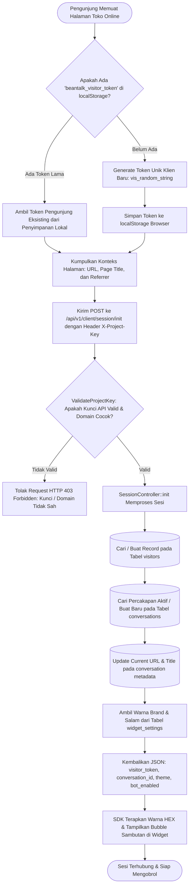

# Modul Inisialisasi Sesi & Handshake Pengunjung (Customer / Visitor)

## 1. Deskripsi Fitur
Modul Inisialisasi Sesi (*Session Handshake*) mengatur mekanisme pengenalan awal saat pengunjung membuka website toko. Begitu script widget dimuat di peramban pembeli, SDK secara otomatis melakukan jabat tangan digital (*handshake*) dengan server BeanTalk:
1. Memvalidasi keabsahan kunci publik proyek (`X-Project-Key`) dan mencocokkan domain asal dengan daftar *whitelisted domains*.
2. Membaca atau membuat token identitas pengunjung (*Visitor Token*) yang tersimpan aman pada `localStorage` peramban, sehingga obrolan tidak hilang saat pengunjung berpindah halaman atau me-refresh browser.
3. Mengirimkan konteks navigasi halaman aktif (*Current URL*, *Page Title*, *Referrer*) ke server agar agen CS dapat mengetahui produk apa yang sedang dilihat pembeli.
4. Menerima konfigurasi tema visual widget (*Primary Accent Color*, mode tema, kalimat salam pembuka) secara dinamis dari database.

---

## 2. Hak Akses & Role Permission
- **Role:** `customer` (Pelanggan / Pengunjung Website)
- **Otentikasi:** Header HTTP `X-Project-Key: pk_live_...`
- **Rate Limiting:** Dibatasi maksimal 100 request/menit per alamat IP untuk mencegah serangan *Denial of Service (DoS)*.

---

## 3. Komponen Teknis & Skema Database

### File Terkait:
- Controller API: `App\Http\Controllers\Api\Client\SessionController` (Metode `init()`)
- Middleware: `App\Http\Middleware\ValidateProjectKey`
- Route: `POST /api/v1/client/session/init`

### Format Payload Request Handshake:
```json
{
  "visitor_token": "vis_98b7c2a10df4e",
  "page_url": "https://indracostore.com/products/kopi-arabika-250g",
  "page_title": "Kopi Arabika Premium 250gr | Indraco Store",
  "referrer": "https://google.com/search?q=kopi+indraco",
  "user_agent": "Mozilla/5.0 (Windows NT 10.0; Win64; x64) Chrome/120.0"
}
```

### Format Payload Respon Handshake:
```json
{
  "success": true,
  "data": {
    "visitor_token": "vis_98b7c2a10df4e",
    "conversation_id": 482,
    "theme": {
      "primary_color": "#C59B27",
      "theme_mode": "light",
      "position": "bottom-right",
      "title": "Indraco Customer Care",
      "subtitle": "Biasanya membalas dalam hitungan menit",
      "welcome_message": "Halo! Ada yang bisa kami bantu seputar pesanan Anda hari ini?"
    },
    "bot_enabled": true
  }
}
```

---

## 4. Flowchart Alur Inisialisasi Sesi & Handshake



---

## 5. Pengalaman Pengguna & Keandalan Koneksi

1. **Persistensi Riwayat Percakapan (*No Chat Loss*):**
   - Saat pembeli mengobrol lalu mengklik tautan produk lain di toko (pindah dari halaman Home ke halaman Cart), obrolan tidak terputus dan tidak menghilang.
   - Sesi lama langsung dimuat kembali secara otomatis berkat token pengunjung yang tersimpan di browser.
2. **Kecepatan Pemuatan (*Sub-Second Handshake*):**
   - Proses jabat tangan berlangsung di latar belakang dalam waktu kurang dari 200 milidetik, tanpa memperlambat waktu pemuatan (*page load time*) halaman website toko.
