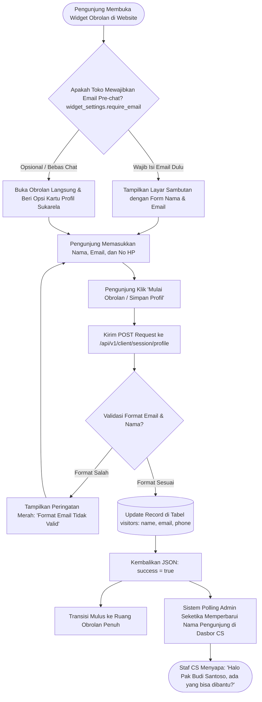

# Modul Profil Pelanggan & Formulir Pre-Chat (Customer / Visitor)

## 1. Deskripsi Fitur
Modul Profil Pelanggan & Formulir Pre-Chat memungkinkan pengunjung toko untuk memperkenalkan diri mereka dengan mengisi nama lengkap, alamat email, atau nomor telepon/WhatsApp. Informasi kontak ini dapat diisi melalui:
1. **Formulir Sambutan Awal (*Pre-Chat Gate*):** Ditampilkan sebelum percakapan dimulai jika toko mewajibkan pengisian email terlebih dahulu.
2. **Formulir Kartu Profil di Dalam Obrolan (*In-Chat Contact Card*):** Ditampilkan sebagai kartu halus di dalam thread chat sehingga pembeli dapat mengisi identitas mereka kapan saja tanpa merasa terpaksa.

Data profil yang diisi pembeli seketika disinkronkan secara real-time ke panel agen CS di Admin Dashboard, sehingga staf CS dapat menyapa pembeli dengan nama aslinya.

---

## 2. Hak Akses & Role Permission
- **Role:** `customer` (Pelanggan / Pengunjung Website)
- **Otentikasi:** Header HTTP `X-Project-Key: pk_live_...`
- **Rate Limiting:** 100 request/menit per alamat IP.

---

## 3. Komponen Teknis & Skema Database

### File Terkait:
- Controller API: `App\Http\Controllers\Api\Client\SessionController` (Metode `updateProfile()`)
- Model: [Visitor.php](file:///C:/laragon/www/%23Project2026/beantalk/app/Models/Visitor.php)
- Route: `POST /api/v1/client/session/profile`

### Format Payload Pengisian Profil:
```json
{
  "visitor_token": "vis_98b7c2a10df4e",
  "name": "Budi Santoso",
  "email": "budi.santoso@gmail.com",
  "phone": "+6281234567890"
}
```

### Validasi Data:
- `visitor_token`: Wajib diisi string terdaftar.
- `name`: Maksimal 100 karakter.
- `email`: Opsional/wajib sesuai konfigurasi, harus berupa format email yang valid (`filter_var EMAIL`).
- `phone`: Maksimal 25 karakter numerik/tanda plus.

---

## 4. Flowchart Alur Pengisian & Sinkronisasi Profil Pelanggan



---

## 5. Pengalaman Pengguna Langkah demi Langkah

1. **Mengisi Identitas Diri:**
   - Saat membuka widget chat, pembeli dapat mengetikkan nama (misal: *Budi Santoso*) dan email mereka.
2. **Keuntungan bagi Pembeli:**
   - Jika pembeli terpaksa menutup browser sebelum agen sempat membalas, pembeli tidak perlu cemas kehilangan jawaban karena tim CS dapat mengirimkan rangkuman balasan ke email yang telah didaftarkan.
3. **Privasi & Keamanan:**
   - Data kontak hanya digunakan oleh divisi layanan pelanggan toko yang bersangkutan dan tidak disebarluaskan ke pihak ketiga.
