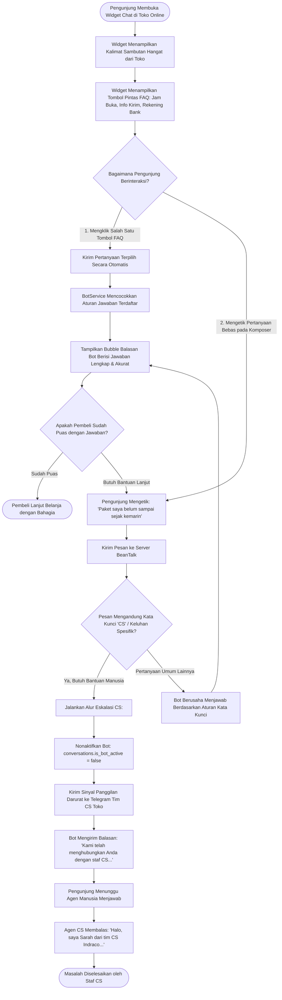

# Modul Interaksi Bot Cerdas & Navigasi FAQ (Customer / Visitor)

## 1. Deskripsi Fitur
Modul Interaksi Bot Cerdas & FAQ memberikan layanan mandiri (*Self-Service Support*) 24 jam sehari bagi pengunjung website toko. Ketika pembeli membuka widget chat di luar jam operasional kerja atau saat seluruh agen CS sedang sibuk melayani pembeli lain:
1. **Pesan Sambutan Cerdas (*Intelligent Welcome Message*):** Menyapa pembeli secara ramah dan memperkenalkan opsi bantuan cepat.
2. **Tombol Pilihan Cepat FAQ (*Interactive Quick Chips*):** Menampilkan tombol pertanyaan umum yang dapat diklik langsung dengan satu sentuhan (misal: *"Jam Operasional"*, *"Cek Resi Pengiriman"*, *"Cara Menjadi Reseller"*).
3. **Pencarian Jawaban Otomatis (*Instant Auto-Answer*):** Menjawab pertanyaan umum dalam hitungan detik tanpa perlu menunggu antrean manusia.
4. **Opsi Eskalasi ke Manusia (*Request Human Agent*):** Jika bot tidak dapat menyelesaikan kendala khusus pembeli, pembeli cukup mengklik tombol atau mengetikkan *"Bicara dengan CS"* untuk dialihkan secara mulus ke agen manusia.

---

## 2. Hak Akses & Role Permission
- **Role:** `customer` (Pelanggan / Pengunjung Website)
- **Akses:** Terbuka bebas untuk seluruh pembeli yang membuka widget obrolan di website toko.

---

## 3. Komponen Teknis & Skema Database

### File Terkait:
- Modul SDK: `packages/chat-sdk/src/bot-chips.ts`
- Service Backend: `App\Services\BotService`
- Konfigurasi Database: Tabel `widget_settings` (kolom `bot_enabled`, `welcome_message`) dan tabel `conversations` (kolom `is_bot_active`, `bot_handoff_at`)

### Kata Kunci Eskalasi yang Dipicu Pengunjung:
Pengunjung dapat memanggil staf manusia dengan mengetik salah satu kata kunci berikut:
- *"cs"*, *"customer service"*, *"operator"*
- *"bantuan staf"*, *"bicara dengan orang"*, *"manusia"*
- *"agen"*

---

## 4. Flowchart Alur Interaksi Pengunjung dengan Bot & Eskalasi CS

---

## 5. Pengalaman Pengguna Praktis

1. **Mendapatkan Jawaban Tanpa Antre:**
   - Pembeli yang ingin mengetahui ongkos kirim ke kota mereka dapat langsung mengklik tombol **Cek Ongkos Kirim**.
   - Jawaban langsung muncul dalam waktu 0.1 detik tanpa perlu menunggu CS membaca pesan.
2. **Kemudahan Menghubungi Manusia:**
   - Pembeli tidak akan merasa frustrasi atau "terjebak" dengan bot yang kaku, karena tombol **Hubungi Staf CS** selalu tersedia setiap saat.
3. **Transisi Percakapan yang Alami:**
   - Saat staf CS manusia mulai membalas, pembeli akan melihat nama dan foto agen yang melayani mereka (contoh: *Sarah Amanda*), memberikan rasa aman dan kepercayaan tinggi pada toko online Anda.
