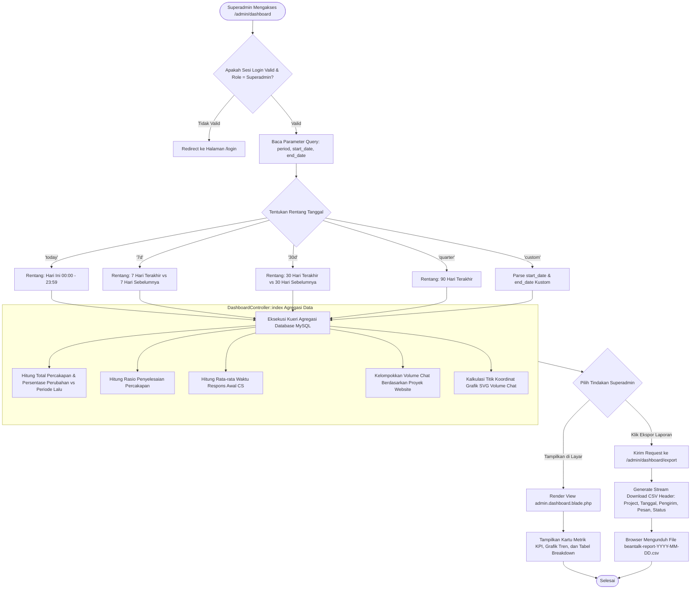

# Modul Dashboard Analitik & Eksekutif KPI (Superadmin)

## 1. Deskripsi Fitur
Modul Dashboard Analitik menyajikan ringkasan kinerja layanan pelanggan (*Customer Service Key Performance Indicators*) tingkat tinggi secara menyeluruh (*real-time aggregate*). Superadmin dapat mengevaluasi volume obrolan masuk, tingkat penyelesaian tiket obrolan, rata-rata durasi respons awal agen (*First Response Time - FRT*), indeks kepuasan pelanggan (*CSAT*), serta distribusi beban pesan antar proyek website toko yang terhubung.

Modul ini dilengkapi dengan filter rentang waktu dinamis (*Today*, *7 Days*, *30 Days*, *This Quarter*, hingga *Custom Date Range*) dan fitur ekspor laporan analitik ke format file CSV untuk kebutuhan rapat manajemen atau audit berkala.

---

## 2. Hak Akses & Role Permission
- **Role:** `superadmin` (Superadmin)
- **Middleware:** `web`, `auth`
- **Batasan Akses:** Hanya dapat diakses oleh staf dengan peran `superadmin`. Agen CS biasa (`agent`) tidak memiliki akses ke halaman ringkasan eksekutif ini untuk menjaga kerahasiaan metrik bisnis dan data agregat perusahaan.

---

## 3. Komponen Teknis & Skema Database

### File Terkait:
- Controller: [DashboardController.php](file:///C:/laragon/www/%23Project2026/beantalk/app/Http/Controllers/Admin/DashboardController.php) (Metode `index()`, `exportReport()`)
- View: `resources/views/admin/dashboard.blade.php`
- Route:
  - `GET /admin` (`name('admin.dashboard')`)
  - `GET /admin/dashboard` (`name('admin.dashboard.index')`)
  - `GET /admin/dashboard/export` (`name('admin.dashboard.export')`)

### Model & Relasi Database:
1. [Conversation](file:///C:/laragon/www/%23Project2026/beantalk/app/Models/Conversation.php):
   - Kolom: `id`, `tenant_id`, `project_id`, `status` (`open`, `pending`, `closed`), `assigned_user_id`, `first_response_at`, `closed_at`, `created_at`.
   - Menghitung total percakapan, percakapan aktif (*open/pending*), dan percakapan selesai (*closed/resolved*).
2. [Message](file:///C:/laragon/www/%23Project2026/beantalk/app/Models/Message.php):
   - Kolom: `id`, `conversation_id`, `sender_type` (`visitor`, `agent`, `bot`, `system`), `body`, `created_at`.
   - Agregasi volume pesan masuk dan pesan keluar per interval tanggal.
3. [Project](file:///C:/laragon/www/%23Project2026/beantalk/app/Models/Project.php):
   - Mengelompokkan statistik berdasarkan masing-masing website toko/klien (misal: *Indraco Store*, *Supresso Global*, dll).
4. [User](file:///C:/laragon/www/%23Project2026/beantalk/app/Models/User.php):
   - Menghitung rasio efisiensi penanganan chat per agen CS.

### Formula Perhitungan Metrik KPI:
1. **Resolution Rate (%):**
   $$\text{Resolution Rate} = \left( \frac{\text{Jumlah Percakapan Status Closed}}{\text{Total Percakapan pada Periode Terpilih}} \right) \times 100\%$$
2. **First Response Time (FRT):**
   $$\text{Avg FRT} = \text{Rata-rata}(\text{first\_response\_at} - \text{created\_at})$$

---

## 4. Flowchart Alur Kerja Dashboard Analitik & Ekspor Laporan

---

## 5. Rincian Antarmuka & Langkah Operasional

### A. Menavigasi dan Mengubah Rentang Periode Analitik:
1. Masuk ke halaman admin dan klik menu **Dashboard** di bilah samping (*sidebar*).
2. Di pojok kanan atas, klik tombol dropdown pilihan periode:
   - **Hari Ini (*Today*)**: Untuk memantau aktivitas jam kerja berjalan.
   - **7 Hari Terakhir (*Last 7 Days*)**: Tampilan bawaan untuk tren mingguan.
   - **30 Hari Terakhir (*Last 30 Days*)**: Analisis bulanan.
   - **Kustom Tanggal (*Custom Range*)**: Memilih tanggal mulai dan tanggal selesai sesuai kebutuhan.
3. Halaman akan menyegarkan data seketika dengan komparasi tren (*badge* hijau untuk kenaikan positif atau merah untuk penurunan).

### B. Mengunduh Laporan CSV:
1. Pada bagian atas dasbor, klik tombol **Export Report (CSV)**.
2. Sistem secara instan menghasilkan stream data CSV berbasis rentang tanggal yang aktif.
3. File CSV dapat langsung dibuka pada Microsoft Excel atau Google Sheets untuk diolah lebih lanjut.
