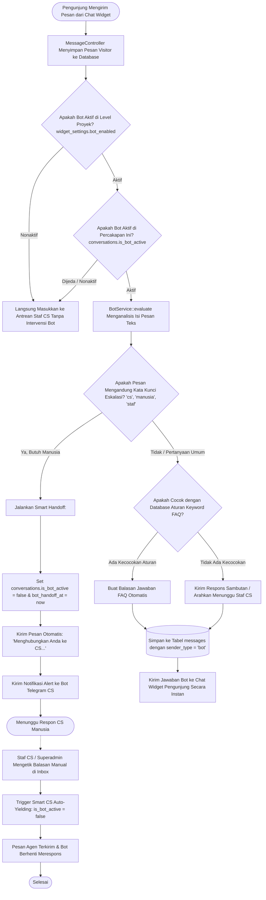

# Modul Smart Bot & Mesin FAQ Otomatis (Superadmin)

## 1. Deskripsi Fitur
Modul Smart Bot & FAQ Engine menyediakan kapabilitas penjawab otomatis (*Automated First-line Responder*) tanpa memerlukan daemon background atau layanan eksternal yang rumit (*Zero-Daemon Architecture*). Bot bekerja secara langsung pada tingkat siklus hidup pesan masuk untuk:
1. Menyapa pengunjung secara otomatis (*Welcome Greeting*) saat sesi pertama kali terbentuk.
2. Mencocokkan pertanyaan pengunjung dengan aturan kata kunci (*Keyword Matching*) untuk memberikan jawaban instan atas pertanyaan umum seputar jam operasional, cara pemesanan, ongkos kirim, dan status garansi.
3. Mendeteksi kebutuhan eskalasi ke manusia (*Smart Handoff*) saat pengunjung mengetik kata kunci darurat (seperti: *"cs"*, *"manusia"*, *"bantuan staf"*, *"bicara dengan orang"*).
4. Mengalah secara otomatis (*Smart CS Auto-Yielding*) saat staf CS manusia mengirim balasan manual, sehingga tidak menginterupsi atau merusak alur percakapan alami.

---

## 2. Hak Akses & Role Permission
- **Role:** `superadmin`
- **Middleware:** `web`, `auth`
- **Tanggung Jawab:** Mengontrol saklar master bot proyek, mengonfigurasi aturan respons FAQ, dan mengevaluasi efektivitas bot dalam mereduksi beban kerja agen CS.

---

## 3. Komponen Teknis & Skema Database

### File Terkait:
- Service Inti: `App\Services\BotService`
- Controller: [DashboardController.php](file:///C:/laragon/www/%23Project2026/beantalk/app/Http/Controllers/Admin/DashboardController.php) (Metode `updateWidgetSettings()`, `toggleBot()`)
- Message Controller API: `App\Http\Controllers\Api\Client\MessageController`

### Arsitektur Aktivasi Dua Tingkat (*Dual-Level Activation*):
1. **Level Proyek (`widget_settings.bot_enabled`):**
   - Saklar master (*master toggle*) yang menentukan apakah bot aktif pada seluruh sesi baru di website tersebut.
2. **Level Percakapan (`conversations.is_bot_active`):**
   - Saklar per-tiket obrolan yang dapat dinyalakan atau dijeda secara individual oleh staf CS di Admin Inbox.

### Kata Kunci Eskalasi Bawaan (*Smart Escalation Keywords*):
```php
$escalationKeywords = ['cs', 'manusia', 'staf', 'operator', 'agent', 'admin', 'bantuan manusia', 'orang'];
```
Jika pesan pengunjung mengandung salah satu kata kunci tersebut, sistem secara otomatis:
1. Menandai percakapan butuh perhatian manusia (`is_bot_active = false`).
2. Merekam waktu eskalasi (`bot_handoff_at = now()`).
3. Mengirim pesan sistem konfirmasi: *"Permintaan Anda dialihkan ke staf Customer Support kami. Mohon tunggu sebentar..."*.
4. Memicu notifikasi darurat ke channel Telegram agen (jika integrasi Telegram aktif).

---

## 4. Flowchart Alur Kerja Mesin Smart Bot & Auto-Yielding



---

## 5. Rincian Antarmuka & Langkah Operasional

1. Buka menu **Integrasi Multi-Site** dan pilih proyek yang dituju.
2. Buka tab **Pengaturan Bot & Penjawab Otomatis**.
3. **Mengaktifkan / Menonaktifkan Bot:**
   - Geser tombol saklar **Aktifkan Smart Bot (Auto-Responder)** ke posisi ON/OFF.
4. **Menentukan Kata Kunci FAQ:**
   - Tentukan pertanyaan umum dan jawaban otomatisnya (contoh: kata kunci *"jam operasional"*, respons: *"Kami melayani setiap hari Senin-Jumat pukul 08:00 - 17:00 WIB"*).
5. **Monitoring di Inbox:**
   - Di halaman Inbox, obrolan yang sedang dilayani bot akan memiliki lencana (*badge*) biru **Bot Active**.
   - Begitu Superadmin atau Agen mengirim balasan chat manual, badge seketika berubah menjadi abu-abu **Bot Paused** untuk menandakan intervensi manusia sedang berlangsung.
