# Modul Log Aktivitas & Audit Trail (Superadmin)

## 1. Deskripsi Fitur
Modul Log Aktivitas & Audit Trail merupakan pusat pencatatan rekam jejak (*traceability & accountability log*) di platform BeanTalk. Modul ini secara otomatis merekam seluruh tindakan penting yang dilakukan oleh Superadmin, Agen CS, maupun sistem otomatis guna menjamin keamanan, kepatuhan audit internal perusahaan, dan investigasi terhadap tindakan yang tidak wajar (*anomalous actions*).

---

## 2. Hak Akses & Role Permission
- **Role:** `superadmin` (Superadmin)
- **Middleware:** `web`, `auth`
- **Tingkat Akses:** Hanya dapat dilihat oleh Superadmin. Catatan log bersifat *append-only* (hanya dapat dibaca dan ditambah, tidak dapat diedit atau dihapus dari antarmuka pengguna).

---

## 3. Komponen Teknis & Skema Database

### File Terkait:
- Controller: [DashboardController.php](file:///C:/laragon/www/%23Project2026/beantalk/app/Http/Controllers/Admin/DashboardController.php) (Metode `logs()`)
- Service Pencatat: `App\Services\ActivityLogger`
- Model: [ActivityLog.php](file:///C:/laragon/www/%23Project2026/beantalk/app/Models/ActivityLog.php)
- View: `resources/views/admin/logs.blade.php`
- Route: `GET /admin/logs` (`name('admin.logs')`)

### Skema Tabel `activity_logs`:
| Kolom | Tipe | Deskripsi |
| :--- | :--- | :--- |
| `id` | BIGINT AUTO_INCREMENT | Identifier primer |
| `tenant_id` | BIGINT FK | Foreign key tenant perusahaan |
| `user_id` | BIGINT FK (Nullable)| Pengguna yang bertindak (NULL jika bot/sistem) |
| `user_role` | ENUM | Peran pelaku: `superadmin`, `agent`, `visitor`, `system` |
| `action` | VARCHAR(50) | Kode aksi (cth: `integration.created`, `team.created`, `chat.assigned`) |
| `description` | TEXT | Rincian deskripsi peristiwa |
| `ip_address` | VARCHAR(45) | Alamat IP perangkat (IPv4 / IPv6) |
| `user_agent` | TEXT | Informasi browser dan sistem operasi |
| `created_at` | TIMESTAMP | Waktu presisi peristiwa terjadi |

---

## 4. Flowchart Alur Pencatatan & Penelusuran Audit Trail

```mermaid
flowchart TD
    subgraph LoggingPhase [Perekaman Otomatis oleh Sistem]
        EventTrigger[Pengguna Melakukan Tindakan Penting cth: Buat Proyek / Ganti Password] --> CallLogger[ActivityLogger::log Dipanggil dari Controller / Service]
        CallLogger --> GatherContext[Kumpulkan Konteks: User ID, Role, IP Address, dan User-Agent Browser]
        GatherContext --> InsertLogDB[(Insert Record ke Tabel activity_logs)]
    end

    subgraph InspectionPhase [Pemeriksaan oleh Superadmin]
        StartInspection([Superadmin Buka Menu Audit Logs /admin/logs]) --> QueryLogs[DashboardController::logs Ambil Data Log dengan Pagination]
        QueryLogs --> RenderLogTable[Render Tabel Log Lengkap dengan Badge Role & Format Tanggal]
        
        RenderLogTable --> FilterChoice{Superadmin Terapkan Filter:}
        FilterChoice --> FilterByRole[Filter Berdasarkan Role: Superadmin / Agent / System]
        FilterChoice --> FilterByAction[Filter Berdasarkan Jenis Aksi cth: auth, team, integration]
        FilterChoice --> FilterByDate[Filter Berdasarkan Rentang Waktu Tertentu]

        FilterByRole & FilterByAction & FilterByDate --> RequeryLogs[Kueri Ulang Data Sesuai Kriteria]
        RequeryLogs --> DisplayFilteredResults[Tampilkan Hasil Audit Terperinci]
        DisplayFilteredResults --> End([Selesai])
    end
```

---

## 5. Rincian Antarmuka & Langkah Supervisi

1. Akses menu **Activity Logs** di sidebar sebelah kiri.
2. Tabel menyajikan informasi kronologis dari peristiwa terbaru:
   - **Waktu:** Tanggal dan jam presisi pencatatan.
   - **Pelaku (*Actor*):** Nama akun beserta badge peran (`Superadmin`, `Agent`, atau `System`).
   - **Tindakan (*Action*):** Kategori aktivitas (contoh: `integration.created`, `api_key.regenerated`, `impersonation.started`).
   - **Deskripsi Detail:** Penjelasan ringkas data apa yang diubah.
   - **Alamat IP & Perangkat:** IP publik dan sistem browser yang digunakan pelaku.
3. Gunakan modul ini secara berkala untuk memantau waktu login staf CS dan memastikan tidak ada perubahan kredensial yang tidak sah.
